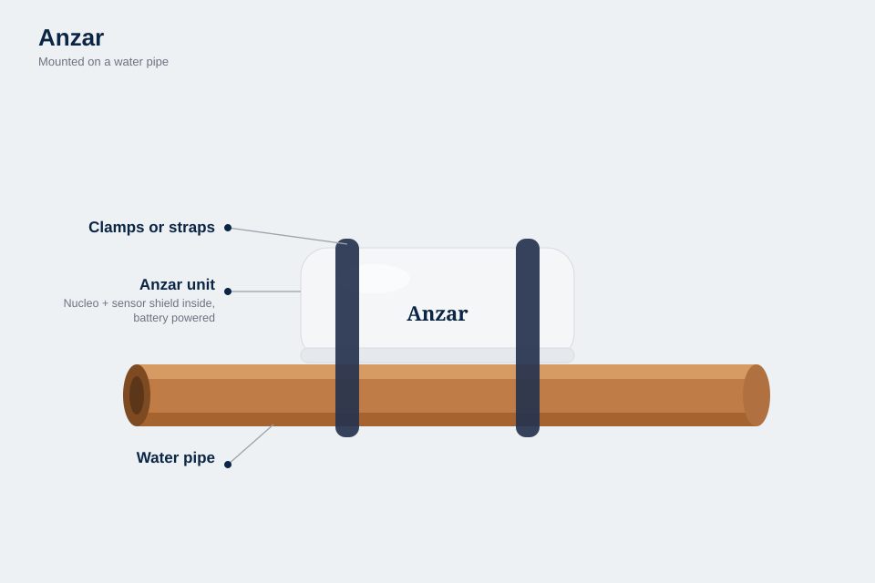
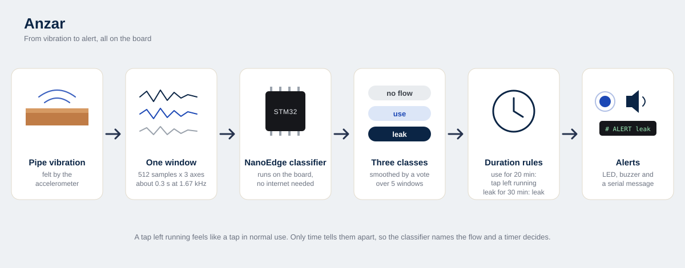
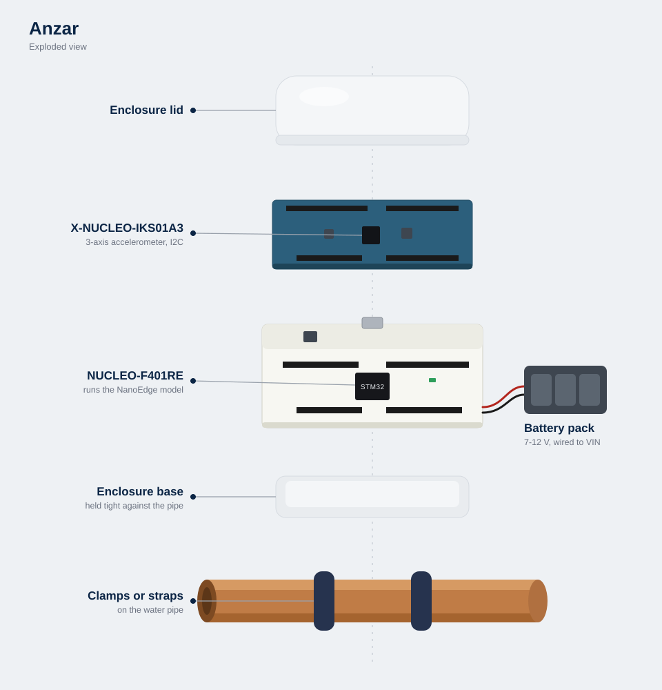

# Anzar

Anzar is a small sensor that sits on a water pipe, feels it vibrate, and tells
a leak apart from normal water use. It also catches taps left running. Everything
runs on the microcontroller, on a battery pack, with no internet connection.



*Anzar (ⴰⵏⵣⴰⵔ) is the Amazigh word for rain, and the name of the rain deity
invoked in North African drought rituals.*

## Why

Roughly a third of Tunisia's drinking water never reaches a tap: by the national
utility's own 2023 figures, the transmission network delivers 86.8% of the water
produced and the distribution network 77.7% of what it receives ([SONEDE 2023
report, as summarised by WMC](https://www.webmanagercenter.com/2025/07/21/549519/sonede-les-chiffres/)).
The same thing happens at small scale in a house or on a farm: a leak behind a wall
or a tap left open in a field keeps running until someone happens to notice.

I'm from Tunisia, where water is scarce and a lot of it is lost this way, so this is
the problem I wanted to work on.

## How it works



1. A MEMS accelerometer on the pipe samples vibration at 1.67 kHz, in windows of
   512 samples on 3 axes (about 0.3 s each).
2. A NanoEdge AI classifier running on the STM32 labels every window: no flow,
   use, or leak.
3. The firmware smooths those labels with a vote over the last five windows and
   keeps time:
   - leak-level flow that lasts 30 minutes raises a **leak** alert;
   - use-level flow that lasts 20 minutes raises a **tap left running** alert.
4. Alerts show on the board's LED (steady for a leak, blinking for a tap) and can
   sound a buzzer. With a computer connected, they are also printed on the serial
   port.

Over any short stretch, a tap left running feels exactly like a tap in normal use.
The only difference is how long it lasts, so the classifier names the flow and a
timer makes the call.

## Hardware



- STM32 NUCLEO-F401RE board
- X-NUCLEO-IKS01A3 MEMS shield (LSM6DSO 3-axis accelerometer)
- a 7-12 V battery pack on the board's VIN pin
- an enclosure, clamped or strapped to the pipe

Parts, assembly and mounting: [docs/hardware.md](docs/hardware.md).

## Repository

```
firmware/app/        application code, drops into an STM32CubeIDE project
firmware/nanoedge/   where the trained NanoEdge library goes (not committed)
tools/capture.py     records labelled training data from the board
tests/               host tests for the decision logic
docs/                hardware, training guide, diagrams
```

## Getting started

1. Set up the firmware project and flash the datalog build:
   [firmware/README.md](firmware/README.md)
2. Record training data and build the model: [docs/training.md](docs/training.md)
3. Flash the detect build.

The decision logic is plain C and has tests that run on any computer with a C
compiler:

```bash
sh tests/run_tests.sh
```

## Status

Prototype. Units are running on household plumbing and on our family's olive grove
in Regueb, Sidi Bouzid. The thresholds above suit a home; long legitimate flows such as
irrigation need a longer tap threshold (see [docs/training.md](docs/training.md)).

## License

MIT, see [LICENSE](LICENSE). ST's LSM6DSO driver and the NanoEdge AI libraries are
not part of this repository and keep their own licenses.
